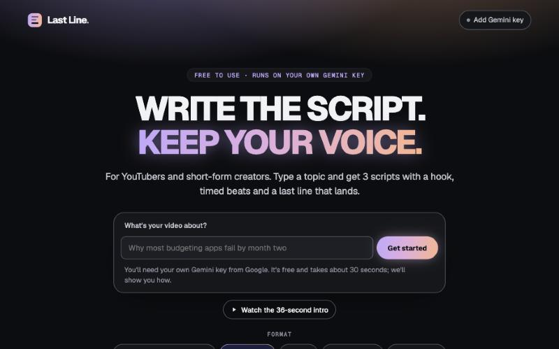
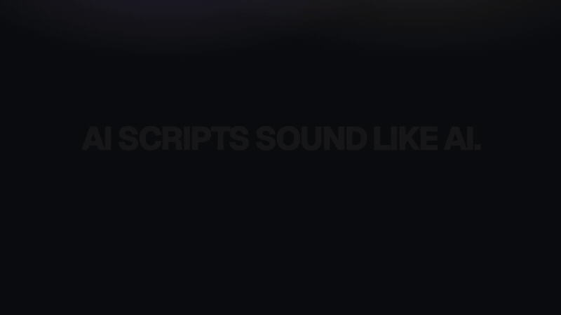
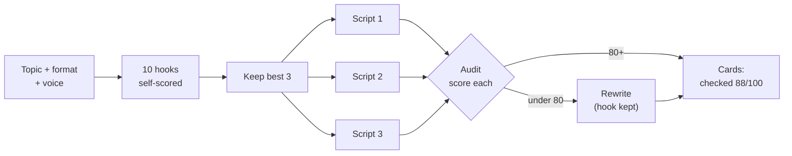

# Last Line

**Short-form video scripts in your own voice, with a hook that stops the scroll and a last line that lands.**

**Live:** [lastline.localcurrent.ai](https://lastline.localcurrent.ai) · free · runs on your own Gemini key



Type a topic, pick a format, and get 3 finished scripts with timed beats. Or get 10 hooks, or paste your own script and get a grade with fixes. Every script is written against a voice: a plain default, an example voice, or your own [voiceprint](https://github.com/brie-wieselman/voiceprint).

## The 36-second intro

Built in [Remotion](https://www.remotion.dev/) (source in [`intro-video/`](intro-video/)): an empty script page fills up, ingredient by ingredient, until it becomes 3 finished scripts.



## How a run works



- **Hooks first, then scripts.** The model writes 10 hooks from a pattern swipe file and scores each one. The top 3 become 3 scripts, written as parallel calls, so one failure doesn't sink the others.
- **A built-in editor.** A final call audits every script against the voice rules and rewrites anything under 80/100. A rewrite that grows past the target length is thrown out, and the one-sentence hook is kept through rewrites.
- **Built for free-tier keys.** Free Gemini keys return 503 and 429 often. Calls retry with backoff, then fall back only to models the key actually lists. If a later step fails, you still get what finished (the hooks, or the unchecked scripts).
- **Per-card edits:** Tighter, Sharper last line, More specific.

## Your voice, imported safely

You can import a voiceprint from a GitHub or Gist link, a file, or paste. Imported text is treated as untrusted:

- https only, GitHub raw and Gist hosts only, redirects re-checked
- 40,000 character cap, HTML refused, control characters stripped
- shown to you before use, fenced in the prompt as style data only, rendered as plain text

## Under the hood

- Plain HTML, CSS and JavaScript. No framework, no build step, no backend: your key stays in your browser and calls go straight to Google.
- Self-hosted Geist fonts, latin subset. First load is about 89 KB; the intro video loads only when you press play.
- Lighthouse mobile: Performance 95 to 100, Accessibility 100.
- Security headers in [`_headers`](_headers) (nosniff, no framing, no camera/mic/location).
- Went through a 20-rule design audit before launch: 32 issues found and fixed, from tap-target size to focus outlines to an OKLCH colour system. The list is in [`FIX-LIST.md`](FIX-LIST.md).

## Run it locally

```bash
git clone https://github.com/brie-wieselman/last-line.git
cd last-line
python3 -m http.server 8000
```

Open http://localhost:8000 and add a free key from [Google AI Studio](https://aistudio.google.com/apikey).

| File | What it holds |
|---|---|
| `index.html`, `styles.css` | The page and the design system |
| `app.js` | The run pipeline, retries, history, voiceprint import |
| `playbook.js` | The prompts: formats, goals, hook patterns, audit rubric, example voice |

## Credits

Inspired by the OUTLIER script-writer idea by sukh28; this is a ground-up rebuild with none of the original code. Fonts: Geist (SIL Open Font License).

## License

MIT, see [`LICENSE`](LICENSE).

---

Built by [Brie Wieselman](https://github.com/brie-wieselman), clinician who builds clinical AI.
